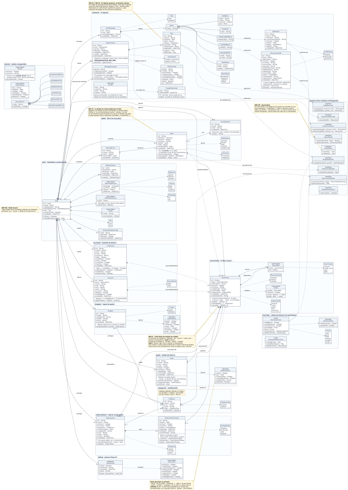

# Diagrama de clases de diseño

Modelo de dominio completo del sistema Deshka: **51 clases, 19 enumeraciones y 9 interfaces**
repartidas en **13 paquetes**, uno por módulo de la aplicación. Corresponde al **numeral 4 del
Entregable #1**.

Está escrito contra el dominio real del backend, no contra una idealización: los nombres de clases y
atributos son los que existen en el código.

## Enlaces

| | |
|---|---|
| 🖼️ **Imagen (SVG, vectorial)** | [`assets/deshka-diagrama-de-clases.svg`](../assets/deshka-diagrama-de-clases.svg) |
| 🖼️ **Imagen (PNG, 5037 × 7069)** | [`assets/deshka-diagrama-de-clases.png`](../assets/deshka-diagrama-de-clases.png) |
| ✏️ **Abrir en PlantUML (editable)** | https://www.plantuml.com/plantuml/uml/5Sp13S8m3030FrF008sHUBMlJi0EnhQQYCIfR8TAdHvutUzM3xGOhLvkHQaEbckEs7q1C3pILYAFrt0nwXgYaQWtUA9zKCxxF3-0nVCReM5Hu4uEN70pR3YnJ5JHnTF-_rTH_la5 |
| ⬇️ **Descargar SVG del servidor** | https://www.plantuml.com/plantuml/svg/5Sp13S8m3030FrF008sHUBMlJi0EnhQQYCIfR8TAdHvutUzM3xGOhLvkHQaEbckEs7q1C3pILYAFrt0nwXgYaQWtUA9zKCxxF3-0nVCReM5Hu4uEN70pR3YnJ5JHnTF-_rTH_la5 |
| ⬇️ **Descargar PNG del servidor** | https://www.plantuml.com/plantuml/png/5Sp13S8m3030FrF008sHUBMlJi0EnhQQYCIfR8TAdHvutUzM3xGOhLvkHQaEbckEs7q1C3pILYAFrt0nwXgYaQWtUA9zKCxxF3-0nVCReM5Hu4uEN70pR3YnJ5JHnTF-_rTH_la5 |
| 📄 **Código fuente** | [`docs/diagrama-de-clases.puml`](./diagrama-de-clases.puml) |

Los enlaces de plantuml.com leen el archivo directamente de este repositorio, así que **siempre
muestran la última versión**: si el modelo cambia, el diagrama publicado cambia con él.



## Cómo leer el diagrama

Cada paquete es un **módulo** del sistema. La frontera es real: en el backend son módulos
independientes de una arquitectura hexagonal que solo se hablan por los **puertos** del paquete
inferior derecho, nunca importando las entidades del vecino.

| Paquete | De qué responde |
|---|---|
| `shared` | Dinero, periodos y la jerarquía de errores de dominio |
| `auth` | Identidad, credenciales, sesión y preferencias del usuario |
| `accounts` | Fuentes de dinero: cuentas de débito, efectivo y tarjetas de crédito |
| `categories` | Catálogo estándar y categorías propias |
| `movements` | **El libro mayor**: gastos, ingresos y transferencias |
| `budgets` | Techo global y topes por categoría |
| `subscriptions` | Cobros recurrentes y su liquidación |
| `debts` | Deudas con personas, contrapartes y gastos compartidos |
| `goals` | Metas de ahorro |
| `assistant` | El agente: chat, borradores, entregas proactivas y cuotas de IA |
| `overview` | Vistas de lectura agregadas — **no persisten nada** |
| `billing` | Planes y beneficios (Fase 5, aún no implementado) |
| *puertos* | Las interfaces por las que un módulo le pide algo a otro |

### Estereotipos

| Estereotipo | Significa |
|---|---|
| `«value object»` | Objeto de valor: sin identidad propia, inmutable |
| `«derivado»` | Se **calcula** al leer; nunca se almacena |
| `«vista»` | Composición de lectura para una pantalla; no es una entidad |
| `«interface»` | Puerto entre módulos (arquitectura hexagonal) |
| `«planeado»` | Diseñado pero todavía no implementado |

## Las cinco decisiones que el diagrama expresa

**1 · La tarjeta de crédito en base caja (RN-01, RN-02).** No hay una clase «pago de tarjeta». Un
consumo es un `Movement` de tipo `expense` cuya fuente es una `CreditCard`: cuenta al presupuesto y
sube la deuda. El pago es un `transfer` de cuenta a tarjeta: baja la deuda y no vuelve a tocar el
presupuesto. Una compra a cuotas sube la deuda por su total el día de la compra.

**2 · Un solo mecanismo para mover plata.** `Movement` produce `Delta`, y quien lo aplica traduce
según el tipo de fuente — *cuenta:* `balance += delta`, *tarjeta:* `debt −= delta`. De ahí caen los
cuatro casos del cash-basis sin ramas especiales, y por eso `type` es **inmutable**: cambiar gasto
por transferencia altera la forma entera del movimiento, no es una edición.

**3 · Nada derivado se persiste.** Lo ahorrado de una `Goal`, el saldo y el estado de una `Debt`, el
consumo de un `Budget` y el saldo neto se calculan al leer, y por eso aparecen como clases
`«derivado»` colgando de su dueño. Un derivado guardado es un campo que se desactualiza.

**4 · La deuda es el acuerdo, no la plata (RN-10).** Registrar una deuda no crea movimientos ni
cambia saldos. Prestar sí los mueve, pero como **transferencia** entre una cuenta y la deuda: el
efectivo se volvió un derecho de cobro y el mes no se encarece. El gasto aparece solo al declararla
incobrable (`writtenOffOn`), que es cuando la pérdida es real.

**5 · El agente propone, el dominio calcula (RN-22, RN-23).** El modelo de lenguaje solo redacta
`Block`; toda cifra viene del cálculo del dominio. Nada se aplica sin confirmación: por eso existen
`MovementDraft` y `Play` como estados intermedios explícitos, con sus propias máquinas de estado.

## Regenerar el diagrama

Requiere Java. La primera vez, descarga `plantuml.jar` de
[plantuml.com/download](https://plantuml.com/download).

```bash
java -DPLANTUML_LIMIT_SIZE=32768 -jar plantuml.jar -Playout=smetana -tsvg -o assets docs/diagrama-de-clases.puml
```

```bash
java -DPLANTUML_LIMIT_SIZE=32768 -jar plantuml.jar -Playout=smetana -tpng -Sdpi=140 -o assets docs/diagrama-de-clases.puml
```

Para regenerar los enlaces de plantuml.com: `python3 tools/plantuml_url.py docs/diagrama-de-clases.puml`
