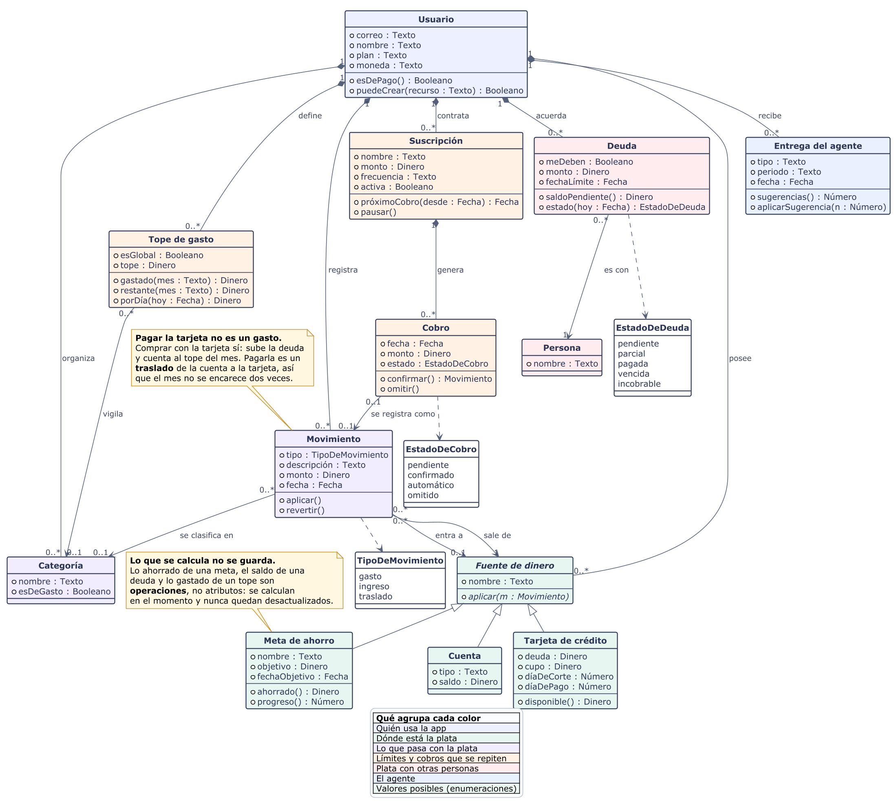

# Diagrama de clases de diseño

La estructura del sistema Deshka en **13 clases y 3 enumeraciones**, con sus atributos, sus
operaciones y las relaciones entre ellas. Corresponde al **numeral 4 del Entregable #1**.

Todo está en español y el color agrupa por área, para que se entienda sin conocer el código.

## Enlaces

| | |
|---|---|
| 🖼️ **Imagen (PNG)** | [`assets/diagrama-de-clases.png`](../assets/diagrama-de-clases.png) |
| 🖼️ **Imagen (SVG, vectorial)** | [`assets/diagrama-de-clases.svg`](../assets/diagrama-de-clases.svg) |
| ✏️ **Abrir el modelo en PlantUML** | https://www.plantuml.com/plantuml/uml/5Sv14e8m3030kw_G1q1BwnJnn0lyGvgam0Y5QLATyVNgQQyxYaBHkgsdov9nhSJdMVMGkp45tksqw5nZ5IwuP-MiBUwRUK1v0N_iC7X3BFCJJ1UTSt6uNNsmgOCOCA65FbaaJju5we8FjpuOsb4CBJ0LsA0XRd05OMcF_s7aJ3-_ |
| 📄 **Código fuente** | [`docs/diagrama-de-clases.puml`](./diagrama-de-clases.puml) |

Las imágenes del repositorio son la versión canónica: son las que van al documento. El enlace de
PlantUML abre el **modelo** en la herramienta, donde puede consultarse y editarse; su render usa
otro motor de dibujo, así que acomoda las mismas clases de otra manera.



## Cómo leer el diagrama

**El usuario es dueño de todo.** Cada cosa del sistema pertenece a un usuario, y nada sobrevive si
se borra la cuenta. Por eso esas relaciones llevan el rombo relleno de la composición.

**«Fuente de dinero» es la idea central.** Una cuenta de banco, una tarjeta de crédito y una meta de
ahorro son todas *lugares donde hay plata*. Comparten un mismo contrato: reciben un movimiento y lo
aplican. La cuenta lo suma a su saldo; la tarjeta lo **resta** a su deuda. De esa única diferencia
sale toda la contabilidad de tarjeta de crédito.

**«Movimiento» es el libro de cuentas.** Un solo tipo de registro sirve para gasto, ingreso y
traslado. El monto siempre es positivo y el tipo decide el signo, así que no puede existir un gasto
negativo.

**Lo que se calcula no se guarda.** Lo ahorrado de una meta, el saldo de una deuda y lo gastado de un
tope aparecen como **operaciones** y no como atributos, justamente porque se calculan en el momento.
Un dato calculado que se guarda es un dato que se desactualiza.

### Los tipos que usa

| Tipo | Qué guarda |
|---|---|
| **Texto** | Palabras: un nombre, una descripción |
| **Dinero** | Un monto, en la unidad menor de la moneda (pesos en COP, centavos en USD) |
| **Número** | Una cantidad o un día del mes |
| **Fecha** | Un día, sin hora |
| **Booleano** | Sí o no |

### Conformidad con UML

| Elemento | Cómo aparece |
|---|---|
| Clase | Tres compartimentos: nombre · atributos · operaciones |
| Visibilidad | `+` público en todos los miembros del modelo |
| Clase abstracta | *Fuente de dinero*, en cursiva, con su operación abstracta también en cursiva |
| Generalización | Triángulo hueco: Cuenta, Tarjeta de crédito y Meta de ahorro heredan de Fuente de dinero |
| Composición | Rombo relleno desde Usuario y desde Suscripción: la parte no sobrevive al todo |
| Asociación | Con nombre, navegabilidad y multiplicidad en ambos extremos |
| Dependencia | Flecha punteada de cada clase hacia la enumeración que usa |
| Enumeración | Los tres conjuntos de valores posibles, en verde |
| Multiplicidad | `1`, `0..1`, `0..*` en cada extremo |

## Regenerar

Requiere Java y `plantuml.jar` ([plantuml.com/download](https://plantuml.com/download)).

```bash
java -DPLANTUML_LIMIT_SIZE=32768 -jar plantuml.jar -Playout=smetana -tpng -Sdpi=150 -o assets docs/diagrama-de-clases.puml
```

---

<sub>El repositorio conserva además `docs/diagrama-de-clases-detallado.puml`, una versión exhaustiva
de 51 clases con los puertos de la arquitectura hexagonal. Quedó fuera del entregable por
complejidad y porque sigue los nombres del código, en inglés.</sub>
