# Modelo C4 de Deshka

**La arquitectura de software de Deshka, del contexto al código, en cuatro niveles de zoom.**

Deshka es un agente financiero personal en forma de aplicación móvil: el usuario registra lo que
gasta y lo que recibe hablando, escribiendo o con un formulario, y el sistema lo organiza, lo
contrasta con sus presupuestos, deudas y metas, y le explica qué está pasando con su plata. Este
documento describe cómo está construido, usando el **modelo C4**.

Todo el modelo vive en este archivo. Los diagramas **no son imágenes**: están escritos como código
[Mermaid](https://mermaid.js.org) dentro del propio Markdown, y cada uno va acompañado de tablas y de
la explicación de lo que contiene.

|                  |                                                                                                                                                                                  |
| ---------------- | -------------------------------------------------------------------------------------------------------------------------------------------------------------------------------- |
| **Proyecto**     | Deshka · Coaching financiero personal, impulsado por IA                                                                                                                          |
| **Curso**        | Diseño de Sistemas de Información · Instituto Tecnológico Metropolitano                                                                                                          |
| **Autores**      | Sebastián Mejía Narváez                                                                                                                                                          |
| **Fecha**        | Octubre de 2026                                                                                                                                                                  |
| **Qué describe** | El sistema tal como está construido hoy: registro manual y asistido, el agente conversacional y el agente proactivo. Lo que todavía no existe aparece marcado como **planeado**. |

## Contenido

1. [El modelo C4 en breve](#1-el-modelo-c4-en-breve)
2. [Nivel 1 · Contexto del sistema](#2-nivel-1--contexto-del-sistema)
3. [Nivel 2 · Contenedores](#3-nivel-2--contenedores)
4. [Nivel 3 · Componentes](#4-nivel-3--componentes)
5. [Nivel 4 · Código](#5-nivel-4--código)
6. [Diagramas complementarios](#6-diagramas-complementarios)
7. [Decisiones de arquitectura y requisitos no funcionales](#7-decisiones-de-arquitectura-y-requisitos-no-funcionales)
8. [Glosario](#8-glosario)
9. [Referencias](#9-referencias)

---

## 1. El modelo C4 en breve

El modelo C4, propuesto por Simon Brown ([c4model.com](https://c4model.com)), describe la
arquitectura de un sistema de software con **cuatro niveles de abstracción jerárquicos**. Funciona
como un mapa con zoom: cada nivel se acerca a una parte del anterior y la muestra con más detalle.
Un **sistema de software** está hecho de **contenedores**; cada contenedor, de **componentes**; y
cada componente se implementa con **código**.

| Nivel | Diagrama             | Pregunta que responde                                                                     | Pensado para                    | En Deshka                                                                        |
| ----- | -------------------- | ----------------------------------------------------------------------------------------- | ------------------------------- | -------------------------------------------------------------------------------- |
| 1     | Contexto del sistema | ¿Qué es el sistema, quién lo usa y con qué otros sistemas se relaciona?                   | Cualquier persona, técnica o no | Deshka, dos personas y cinco sistemas externos                                   |
| 2     | Contenedores         | ¿Qué aplicaciones y almacenes de datos lo forman, con qué tecnología y cómo se comunican? | Equipo técnico y de operación   | App móvil, API REST, worker, MongoDB y Redis, más un almacén de recibos planeado |
| 3     | Componentes          | ¿Cómo está organizado por dentro cada contenedor?                                         | Desarrolladores                 | Los diez módulos del backend y las capas de la app móvil                         |
| 4     | Código               | ¿Cómo está implementado un componente?                                                    | Quien trabaja en ese componente | Las clases del módulo `movements`                                                |

Además de los cuatro niveles, C4 contempla **diagramas complementarios**: el **dinámico**, que
muestra cómo colaboran los elementos en un caso concreto, y el de **despliegue**, que muestra dónde
corre cada contenedor. Ambos están en la [sección 6](#6-diagramas-complementarios).

### 1.1 Las abstracciones

| Abstracción             | Qué es                                                                                                                                                                                            | Ejemplo en Deshka                       |
| ----------------------- | ------------------------------------------------------------------------------------------------------------------------------------------------------------------------------------------------- | --------------------------------------- |
| **Persona**             | Alguien que usa el sistema o que se ve afectado por él.                                                                                                                                           | El usuario que registra sus gastos.     |
| **Sistema de software** | Lo que entrega valor a sus usuarios. Es el nivel más alto de abstracción.                                                                                                                         | Deshka; la API de Anthropic.            |
| **Contenedor**          | Una aplicación o un almacén de datos que se ejecuta por separado y que tiene que estar funcionando para que el sistema funcione. **No es un contenedor de Docker**: es una frontera de ejecución. | La app móvil, la API, la base de datos. |
| **Componente**          | Una agrupación de funcionalidad con una interfaz bien definida, dentro de un contenedor. No se despliega por sí sola.                                                                             | El módulo `movements` dentro de la API. |
| **Código**              | Las clases, interfaces y funciones que implementan un componente.                                                                                                                                 | `Movement`, `CreateMovementUseCase`.    |

### 1.2 Notación

Todos los diagramas usan la misma notación, con los colores habituales de C4:

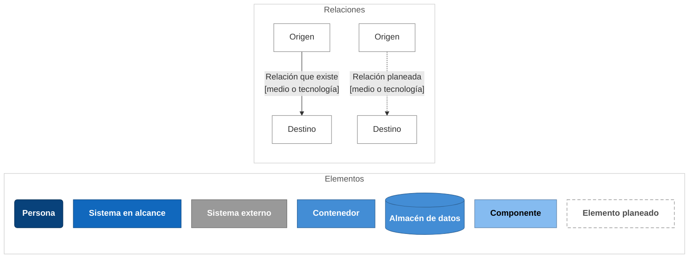

- Cada elemento muestra su **nombre**, entre corchetes su **tipo** y su **tecnología**, y una
**descripción** corta de su responsabilidad.
- Cada relación es una frase con verbo que se lee en el sentido de la flecha y, entre corchetes, el
**medio**: el protocolo o la tecnología con que ocurre.
- **Línea continua**: la relación existe hoy. **Línea punteada** o **borde punteado**: la relación o
el elemento están **planeados** y todavía no existen.
- El **recuadro punteado sin relleno** marca el límite del sistema o del contenedor al que se le
hace zoom. Dentro quedan las piezas que el equipo construye; fuera, las que solo usa.

### 1.3 Cómo leer este documento

- Los diagramas están escritos en **Mermaid**, un lenguaje de *diagramas como código*. GitHub los
dibuja automáticamente al abrir el archivo; en VS Code basta la extensión *Markdown Preview
Mermaid Support*, y cualquier bloque puede pegarse en [mermaid.live](https://mermaid.live).
- Aun sin dibujarlos, el código se lee: cada línea declara un elemento o una relación con su texto
completo, y las tablas que siguen a cada diagrama repiten esa información de forma ordenada.
- Cada nivel sigue la misma estructura: la **pregunta** que responde, el **diagrama**, las tablas de
**elementos** y **relaciones**, y las **decisiones** de arquitectura que explican por qué es así.
- Los códigos `RF-XX`, `RNF-XX` y `RN-XX` remiten a los requisitos funcionales, no funcionales y
reglas de negocio del Entregable #1.

---

## 2. Nivel 1 · Contexto del sistema

> **Pregunta que responde:** ¿qué es Deshka, quién lo usa y con qué otros sistemas se relaciona?

En este nivel Deshka es una sola caja: todavía no importa cómo está construida por dentro, sino
quién la usa y de quién depende. Hay una persona que la usa todos los días, otra que solo recibe algo
que el sistema produjo, dos servicios externos ya integrados y tres planeados.

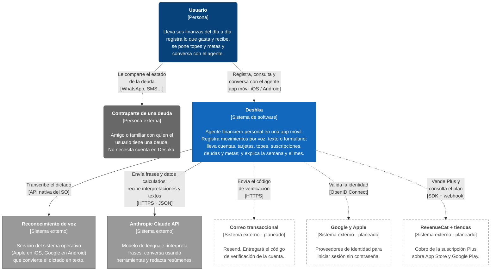

*Figura 1. Diagrama de contexto del sistema.*

### 2.1 Personas y sistemas

| Elemento                     | Tipo                             | Descripción                                                                                                                                                                                                                                         | Estado      |
| ---------------------------- | -------------------------------- | --------------------------------------------------------------------------------------------------------------------------------------------------------------------------------------------------------------------------------------------------- | ----------- |
| **Usuario**                  | Persona                          | Quiere llevar el control de su dinero sin digitar a mano: registra gastos e ingresos, se pone topes y metas, lleva sus deudas y conversa con el agente. Antes de crear su cuenta es un *visitante*.                                                 | ✅ Existe    |
| **Contraparte de una deuda** | Persona externa                  | Amigo o familiar con quien el usuario tiene una deuda. Recibe el estado de la deuda como texto; no usa Deshka ni necesita cuenta (RF-38).                                                                                                           | ✅ Existe    |
| **Deshka**                   | Sistema de software (en alcance) | El sistema que se construye: app móvil, backend y almacenamiento. Lleva cuentas, tarjetas de crédito con modelo de caja, movimientos, topes, suscripciones, deudas y metas, y un agente que conversa, resume la semana y el mes y propone acciones. | ✅ Existe    |
| **Reconocimiento de voz**    | Sistema externo                  | El dictado del sistema operativo (Apple en iOS, Google en Android). Convierte la voz en texto en el teléfono; Deshka no envía audio a su servidor.                                                                                                  | ✅ Integrado |
| **Anthropic Claude API**     | Sistema externo                  | Modelo de lenguaje que interpreta frases, conversa usando las herramientas que Deshka le ofrece y redacta El Corte del mes y la revisión semanal. Nunca calcula cifras: las recibe ya calculadas (RN-23).                                           | ✅ Integrado |
| **Correo transaccional**     | Sistema externo                  | Resend. Enviará el código de verificación al crear la cuenta; hoy el servidor solo lo escribe en su registro de eventos.                                                                                                                            | ⏳ Planeado  |
| **Google y Apple**           | Sistema externo                  | Proveedores de identidad para entrar sin contraseña (HU-06).                                                                                                                                                                                        | ⏳ Planeado  |
| **RevenueCat + tiendas**     | Sistema externo                  | Cobro de la suscripción Plus a través de App Store y Google Play (RF-51); avisa a Deshka cada cambio de plan.                                                                                                                                       | ⏳ Planeado  |

### 2.2 Relaciones

| Origen → destino               | Qué ocurre                                                                                                             | Medio                                           |
| ------------------------------ | ---------------------------------------------------------------------------------------------------------------------- | ----------------------------------------------- |
| Usuario → Deshka               | Registra movimientos, consulta su panorama, conversa con el agente y aplica las acciones que este le propone.          | App móvil (iOS / Android)                       |
| Usuario → Contraparte          | Le comparte el recordatorio que Deshka arma con el estado de la deuda.                                                 | Hoja de compartir del teléfono (WhatsApp, SMS…) |
| Deshka → Reconocimiento de voz | Transcribe lo que el usuario dicta.                                                                                    | API nativa del sistema operativo                |
| Deshka → Anthropic             | Envía la frase capturada o la pregunta junto con datos ya calculados, y recibe la interpretación o el texto redactado. | HTTPS · JSON                                    |
| Deshka → Correo                | Enviará el código de verificación.                                                                                     | HTTPS (planeado)                                |
| Deshka → Google y Apple        | Validará la identidad del usuario.                                                                                     | OpenID Connect (planeado)                       |
| Deshka → RevenueCat            | Venderá Plus y consultará el plan activo; RevenueCat avisará los cambios por webhook.                                  | SDK + webhook (planeado)                        |

### 2.3 Lo que queda fuera, a propósito

- **Bancos y agregadores bancarios.** Deshka no se conecta a entidades financieras: el usuario es la
fuente de los datos, y por eso registrar debe costar casi nada. La sincronización bancaria tiene
cobertura débil fuera de Estados Unidos (Entregable #1, modelo verbal).
- **Publicidad y venta de datos.** No hay redes publicitarias ni terceros que reciban los datos
financieros con fines comerciales (RNF-19).
- **Asesoría financiera regulada.** El agente orienta; no asesora (RN-26).

### 2.4 Decisiones de este nivel

1. **La inteligencia artificial es un sistema externo, no una pieza propia.** Deshka no entrena ni
 aloja modelos: usa uno a través de una interfaz propia que permite cambiar de proveedor sin tocar
 el resto del sistema (ver el puerto `AgentModel` en el [nivel 3](#4-nivel-3--componentes)).
2. **El modelo de lenguaje redacta; Deshka calcula.** Toda cifra que ve el usuario sale del dominio.
 El modelo recibe los números ya calculados y solo escribe el texto que los acompaña (RN-23).
3. **La voz se transcribe en el teléfono.** El reconocedor del sistema operativo no tiene costo por
 uso y el audio nunca llega al servidor de Deshka: lo que viaja es texto.
4. **Sin IA, Deshka sigue funcionando.** El registro manual no depende de ningún sistema externo, y si
 el modelo falla, los resúmenes salen igual con plantillas fijas (RNF-05).

---

## 3. Nivel 2 · Contenedores

> **Pregunta que responde:** ¿qué aplicaciones y almacenes de datos forman Deshka, con qué
> tecnología está hecho cada uno y cómo se comunican?

Al hacer zoom sobre la caja de Deshka aparecen **cinco contenedores en funcionamiento y uno
planeado**. Para que el diagrama se lea, se presenta en dos vistas: la arquitectura que funciona hoy
y las integraciones planeadas.

### 3.1 Vista actual

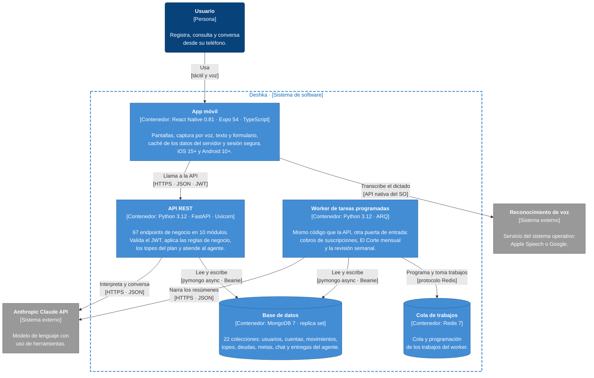

*Figura 2. Contenedores en funcionamiento.*

### 3.2 Integraciones planeadas

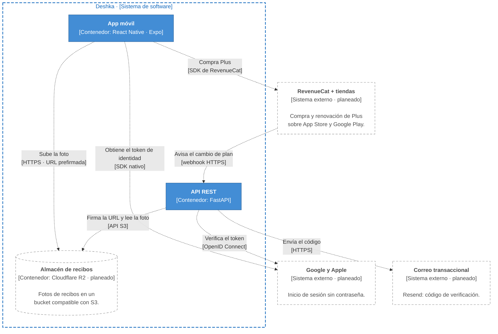

*Figura 3. Contenedores e integraciones planeados.*

### 3.3 Contenedores

| Contenedor                          | Tecnología                                                                                                                                                                      | Responsabilidad                                                                                                                                                                                                                   | Dónde corre                                 |
| ----------------------------------- | ------------------------------------------------------------------------------------------------------------------------------------------------------------------------------- | --------------------------------------------------------------------------------------------------------------------------------------------------------------------------------------------------------------------------------- | ------------------------------------------- |
| **App móvil**                       | React Native 0.81 y Expo 54 como *development build*, TypeScript estricto, Expo Router 6, TanStack Query 5, Zustand, Axios, i18next, expo-speech-recognition, expo-secure-store | Única interfaz del usuario: pantallas, captura por voz, texto o formulario, borradores para confirmar, Inicio y los resúmenes del agente. Guarda la sesión en el almacén seguro del teléfono y muestra todo en español o inglés.  | Teléfono del usuario (iOS 15+, Android 10+) |
| **API REST**                        | Python 3.12, FastAPI, Uvicorn, Pydantic 2, PyJWT, Argon2, SDK oficial de Anthropic                                                                                              | 67 endpoints de negocio (más `/healthz` y `/readyz`). Autentica cada petición, aplica las reglas de negocio —modelo de caja, topes, límites del plan gratuito— y atiende al agente en línea: chat y captura asistida.             | Servidor                                    |
| **Worker de tareas programadas**    | Python 3.12, ARQ                                                                                                                                                                | Ejecuta lo que nadie pide desde la app: liquida los cobros de suscripciones (cada hora), compone El Corte del mes anterior (día 1, 06:00 UTC) y la revisión semanal (lunes, 07:00 UTC). Comparte código y composición con la API. | Servidor                                    |
| **Base de datos**                   | MongoDB 7 en *replica set*, con Beanie (ODM) sobre el cliente asíncrono de pymongo                                                                                              | Persistencia de todo el dominio en 22 colecciones. El *replica set* es lo que habilita las transacciones multi-documento (RNF-09).                                                                                                | Servidor                                    |
| **Cola de trabajos**                | Redis 7                                                                                                                                                                         | Cola y coordinación de ARQ: el worker encola y consume sus propios trabajos programados. Hoy la API no encola nada; la cola queda lista para trabajos bajo demanda.                                                               | Servidor                                    |
| **Almacén de recibos** *(planeado)* | Cloudflare R2, compatible con S3                                                                                                                                                | Guardará las fotos de recibos para la captura por foto (RF-17). La app las subirá directamente con una URL prefirmada que emite la API.                                                                                           | Nube de Cloudflare                          |

### 3.4 Relaciones

| Origen → destino                  | Qué ocurre                                                                                                                                                 | Protocolo / tecnología                        |
| --------------------------------- | ---------------------------------------------------------------------------------------------------------------------------------------------------------- | --------------------------------------------- |
| Usuario → App móvil               | Toca, escribe y dicta.                                                                                                                                     | Interfaz táctil y micrófono                   |
| App móvil → Reconocimiento de voz | Escucha en modo continuo y recibe la transcripción en vivo; solo el texto sigue hacia la API.                                                              | `expo-speech-recognition` sobre la API nativa |
| App móvil → API REST              | Toda la información de negocio. Cada petición privada lleva `Authorization: Bearer <JWT>`; ante un 401 la app refresca la sesión una sola vez y reintenta. | HTTPS · JSON                                  |
| API REST → Base de datos          | Lecturas y escrituras; las operaciones que tocan varios documentos van dentro de una transacción.                                                          | Protocolo de MongoDB · pymongo async          |
| API REST → Anthropic              | Chat con uso de herramientas y captura en lenguaje natural, con *prompt caching*.                                                                          | HTTPS · JSON (SDK oficial)                    |
| Worker → Cola de trabajos         | Encola y toma sus trabajos cron.                                                                                                                           | Protocolo de Redis (ARQ)                      |
| Worker → Base de datos            | Lee el periodo que se cerró y guarda las entregas y los cobros.                                                                                            | pymongo async                                 |
| Worker → Anthropic                | Redacta El Corte y la revisión semanal.                                                                                                                    | HTTPS · JSON                                  |
| App móvil → Almacén de recibos    | Subirá la foto del recibo.                                                                                                                                 | HTTPS con URL prefirmada *(planeado)*         |
| API REST → Almacén de recibos     | Firmará las URL y leerá la foto para interpretarla.                                                                                                        | API S3 *(planeado)*                           |
| App móvil → RevenueCat            | Comprará Plus.                                                                                                                                             | SDK de RevenueCat *(planeado)*                |
| RevenueCat → API REST             | Avisará cada compra, renovación o cancelación.                                                                                                             | Webhook HTTPS *(planeado)*                    |
| App móvil / API → Google y Apple  | La app obtendrá el token de identidad y la API lo verificará antes de emitir su propio JWT.                                                                | SDK nativo · OpenID Connect *(planeado)*      |
| API REST → Correo                 | Enviará el código de verificación.                                                                                                                         | HTTPS *(planeado)*                            |

### 3.5 Decisiones de este nivel

1. **Un solo código backend, dos procesos.** La API y el worker son el mismo código Python —un
 *monolito modular*— arrancado de dos formas: `uvicorn src.core.app:app` y
 `arq src.core.workers.WorkerSettings`. Los dos registran la misma lista de documentos
 (`core/documents.py`) para que nunca diverjan. Un solo equipo, transacciones que cruzan módulos
 y una operación más simple pesaron más que separar servicios; las fronteras entre módulos se
 vigilan de todos modos en el código ([nivel 3](#4-nivel-3--componentes)), así que un módulo podría
 extraerse después.
2. **MongoDB en *replica set*, aunque sea un solo nodo.** MongoDB solo permite transacciones
 multi-documento sobre un *replica set*, y el modelo de caja las necesita: pagar la tarjeta baja el
 saldo de la cuenta **y** la deuda de la tarjeta, y la mitad de eso sería un libro contable que
 miente.
3. **El reloj también es una puerta de entrada.** Los trabajos programados viven en el módulo dueño
 (`subscriptions`, `assistant`), igual que sus routers; el worker solo los registra. Son
 idempotentes por construcción y se ejecutan también al arrancar, como recuperación después de un
 despliegue o una caída (RNF-10).
4. **El modelo de lenguaje nunca se llama dentro de una transacción.** Una llamada tarda segundos.
 Primero se habla con el modelo y después se confirma todo junto —borrador, respuesta y contador de
 uso— en una transacción corta. Así no puede existir un turno cobrado sin respuesta.
5. **Sesión sin estado en el servidor.** JWT firmado (HS256) con vigencia de 15 minutos y un token de
 refresco de 30 días que rota en cada uso; reutilizar uno viejo revoca toda la familia de tokens.
 En el teléfono se guardan en Keychain / Keystore, nunca en almacenamiento plano.

---

## 4. Nivel 3 · Componentes

> **Pregunta que responde:** ¿cómo está organizado por dentro cada contenedor que tiene código
> propio?

Deshka tiene dos bases de código: la del **backend**, que se despliega como dos contenedores (la API
y el worker), y la de la **app móvil**. Esta sección hace zoom en cada una. MongoDB y Redis son
productos de terceros que solo se configuran, así que no se descomponen.

### 4.1 Backend: API REST y worker

La API y el worker comparten **un solo diagrama de componentes** porque son el mismo código: lo único
que cambia es la puerta de entrada, la **aplicación web** para la API y el **programador de
trabajos** para el worker.

Cada **componente de negocio** es un **módulo** construido con **arquitectura hexagonal** (puertos y
adaptadores), uno por cada contexto del dominio. Su interfaz pública son sus **casos de uso**; lo que
necesita del exterior —base de datos, modelo de lenguaje u otro módulo— lo pide a través de
**puertos** (interfaces) que implementan **adaptadores**.

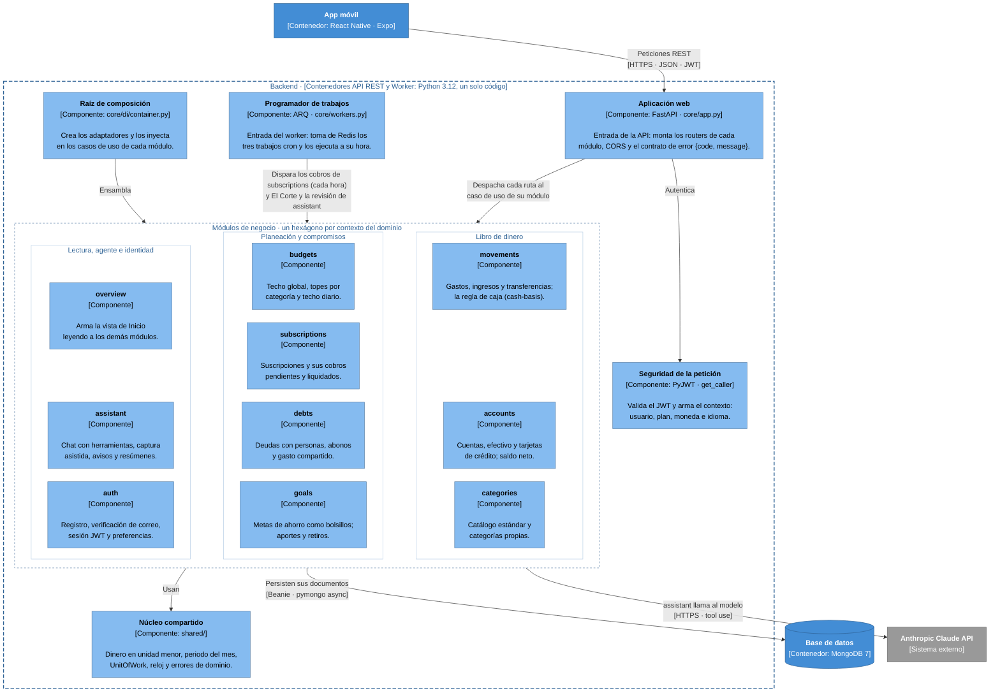

*Figura 4. Componentes del backend. Las dependencias entre módulos se detallan en la
[sección 4.2](#42-cómo-se-comunican-los-módulos).*

#### Componentes de infraestructura

| Componente                   | Responsabilidad                                                                                                                                                                                                                                                                                      | Ubicación en el código                                              |
| ---------------------------- | ---------------------------------------------------------------------------------------------------------------------------------------------------------------------------------------------------------------------------------------------------------------------------------------------------- | ------------------------------------------------------------------- |
| **Aplicación web**           | Puerta de entrada de la API: crea la aplicación FastAPI, conecta la base de datos al arrancar, monta los routers de los diez módulos, configura CORS y traduce cualquier error de dominio al contrato `{code, message}` con su estado HTTP.                                                          | `core/app.py`, `shared/adapters/inbound/http/exception_handlers.py` |
| **Programador de trabajos**  | Puerta de entrada del worker: registra los tres trabajos cron y sus horarios; ARQ los encola en Redis y los ejecuta a su hora. Cada trabajo vive en su módulo dueño, como un router: `run_subscription_charges` en `subscriptions`, y `run_monthly_summaries` y `run_weekly_reviews` en `assistant`. | `core/workers.py`                                                   |
| **Seguridad de la petición** | Valida el JWT del encabezado `Authorization` y arma el `CallerContext` (usuario, plan, moneda, objetivo e idioma) que reciben los casos de uso. Ningún dato de identidad viene del cuerpo de la petición.                                                                                            | `shared/adapters/inbound/http/dependencies.py`                      |
| **Raíz de composición**      | Instancia cada adaptador y lo inyecta en los casos de uso. Es el único lugar que conoce a la vez las implementaciones concretas y todos los módulos.                                                                                                                                                 | `core/di/container.py`                                              |
| **Núcleo compartido**        | Solo lo que dos módulos deben mostrar idéntico: el dinero en unidad menor (`money.py`), el periodo del mes, la proyección del mes, la jerarquía de errores de dominio y los puertos `UnitOfWork` y `Clock` con sus implementaciones.                                                                 | `shared/`                                                           |

#### Componentes de negocio

| Componente          | Responsabilidad                                                                                                                                                                                                                                                                                                                                | Colecciones propias                                   | Endpoints                                         |
| ------------------- | ---------------------------------------------------------------------------------------------------------------------------------------------------------------------------------------------------------------------------------------------------------------------------------------------------------------------------------------------- | ----------------------------------------------------- | ------------------------------------------------- |
| `**auth**`          | Registro con correo y contraseña (Argon2), código de verificación (6 dígitos, 15 minutos, 5 intentos), sesión JWT con refresco rotativo, perfil y preferencias (idioma, moneda, objetivo). Bloquea el cambio de moneda si ya hay historial (RN-18).                                                                                            | `users`, `email_verification_codes`, `refresh_tokens` | `/auth` (9)                                       |
| `**categories**`    | Catálogo estándar de 15 categorías (12 de gasto y 3 de ingreso) versionado en el código, más las categorías propias del usuario (2 en el plan gratuito).                                                                                                                                                                                       | `categories`                                          | `/categories` (4)                                 |
| `**accounts**`      | Cuentas bancarias y efectivo; tarjetas de crédito como entidad aparte (cupo, deuda, día de corte y de pago); saldo neto = cuentas − deuda de las tarjetas. Plan gratuito: 2 cuentas y 1 tarjeta.                                                                                                                                               | `accounts`, `credit_cards`                            | `/accounts` (4), `/credit-cards` (3)              |
| `**movements**`     | El libro contable: gasto, ingreso y transferencia con la regla de caja; edición y borrado que revierten su efecto; idempotencia; agregados del periodo (totales, gasto por categoría y por día, comercios principales, fondos de cada meta).                                                                                                   | `movements`, `idempotency_keys`                       | `/movements` (5)                                  |
| `**subscriptions**` | Suscripciones con monto, periodicidad y día de cobro. Abre el cobro el día que vence; el usuario lo confirma u omite, y si no responde en 3 horas se registra solo (RF-32, RF-33).                                                                                                                                                             | `subscriptions`, `subscription_charges`               | `/subscriptions` (4), `/subscription-charges` (3) |
| `**budgets**`       | Techo global y topes por categoría, vigentes hasta que el usuario los cambie (RN-06); lo gastado, el techo diario y los comercios principales de cada tope. Plan gratuito: 2 topes por categoría.                                                                                                                                              | `budgets`                                             | `/budgets` (4)                                    |
| `**debts**`         | Deudas con personas en ambos sentidos, abonos parciales, gasto compartido en una sola operación y condonación. El dinero prestado viaja como una transferencia real.                                                                                                                                                                           | `debts`, `debt_counterparties`, `debt_shared_events`  | `/debts` (9)                                      |
| `**goals**`         | Metas como bolsillos: aportes y retiros son transferencias reales y lo ahorrado se deriva de ellas (RN-14); proyección de cumplimiento. Plan gratuito: 1 meta activa.                                                                                                                                                                          | `goals`                                               | `/goals` (6)                                      |
| `**overview**`      | Arma la pantalla de Inicio en una sola respuesta: saldo neto, gasto y ritmo del mes, techo diario, meta principal, deudas y próximos cobros; elige qué destacar según el objetivo del usuario. No guarda datos propios.                                                                                                                        | —                                                     | `/home` (1)                                       |
| `**assistant**`     | El agente: chat con 14 herramientas, captura asistida (`/parse`), borradores que el usuario confirma, avisos calculados con reglas (sin IA), El Corte del mes y la revisión semanal con jugadas aplicables, contadores de uso y costo de cada llamada al modelo. Es el único módulo que habla con Anthropic, a través del puerto `AgentModel`. | 7 colecciones `assistant_*`                           | `/assistant` (15)                                 |

#### Anatomía de un módulo

Los diez módulos tienen la misma estructura interna. La regla es que las dependencias apuntan
siempre hacia el dominio:

| Capa                       | Carpeta              | Qué contiene                                                                                                                | Puede depender de                     |
| -------------------------- | -------------------- | --------------------------------------------------------------------------------------------------------------------------- | ------------------------------------- |
| **Dominio**                | `domain/`            | Entidades (*dataclasses* inmutables), objetos de valor, reglas puras y errores de dominio. Sin frameworks ni base de datos. | Solo de sí misma y de `shared/domain` |
| **Aplicación**             | `application/`       | Casos de uso (los puertos de entrada), puertos de salida (`typing.Protocol`) y DTO.                                         | Dominio                               |
| **Adaptadores de entrada** | `adapters/inbound/`  | Routers HTTP (FastAPI) y trabajos programados (ARQ): lo que *maneja* la aplicación.                                         | Aplicación y dominio                  |
| **Adaptadores de salida**  | `adapters/outbound/` | Repositorios MongoDB (documentos Beanie y mapeadores), el cliente de Anthropic y los adaptadores hacia otros módulos.       | Los puertos que implementan           |

Estas reglas no son una convención de palabra: **41 contratos de `import-linter`** las verifican en
cada cambio, y un `import` que las viole rompe la verificación (RNF-17).

### 4.2 Cómo se comunican los módulos

Ningún módulo importa el interior de otro. Cuando un módulo necesita algo de un vecino, **declara en
su propia capa de aplicación un puerto** con exactamente lo que necesita, y un **adaptador de
salida** lo implementa llamando a los casos de uso o a los repositorios del vecino. Ese adaptador es
una **capa anticorrupción**: traduce los conceptos de un módulo a los del otro, y el hexágono nunca se
entera de que el vecino existe.

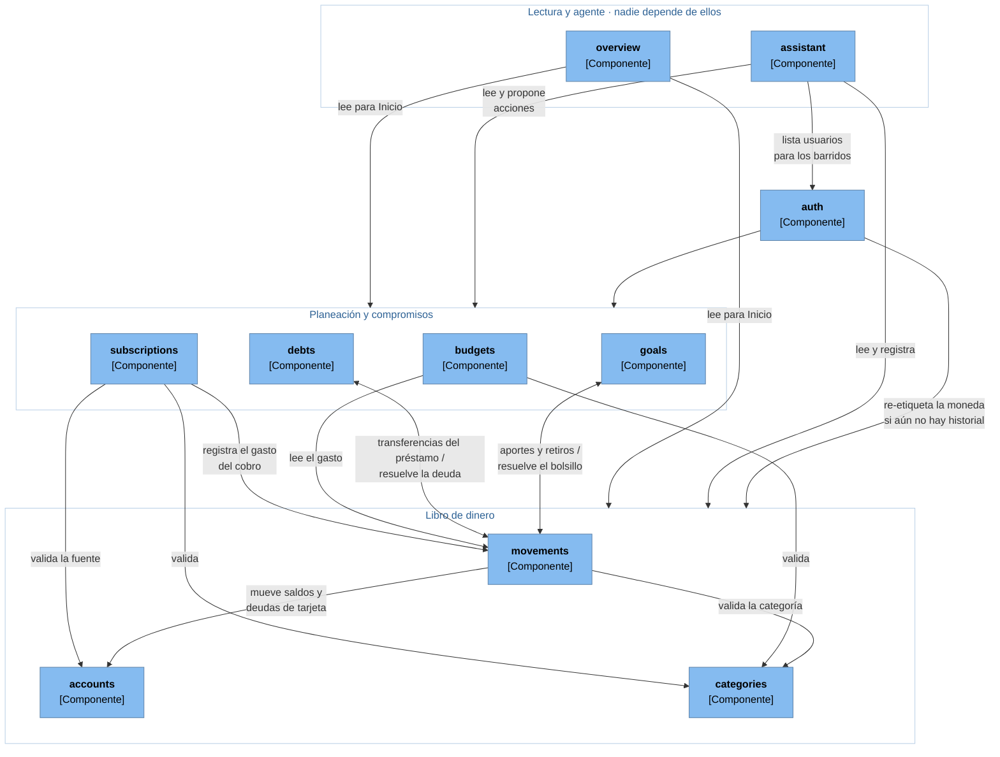

*Figura 5. Dependencias entre los módulos del backend. Una flecha hacia un grupo significa
que el módulo depende de varios de sus integrantes; la tabla siguiente lo detalla.*

**Cómo leerlo.** `movements` es el centro: todo lo que mueve plata termina ahí, y por eso
`subscriptions`, `debts` y `goals` registran sus efectos a través de él en vez de escribir saldos por
su cuenta. Las dos flechas de doble sentido no son un ciclo en el dominio: `goals` y `debts` le piden
a `movements` que registre una transferencia, y `movements` les pregunta si el bolsillo o la deuda
existen y son del usuario; cada sentido usa un puerto distinto. `overview` y `assistant` son hojas:
leen a casi todos y ningún módulo puede depender de ellos, y dos contratos de `import-linter` lo
garantizan.

| Módulo que consume | Módulo proveedor                                                                    | Para qué                                                                                                                        | Puerto (del consumidor) → adaptador                                                                                           |
| ------------------ | ----------------------------------------------------------------------------------- | ------------------------------------------------------------------------------------------------------------------------------- | ----------------------------------------------------------------------------------------------------------------------------- |
| `movements`        | `accounts`                                                                          | Verificar la fuente y aplicar el efecto en el saldo de la cuenta o en la deuda de la tarjeta                                    | `SourceLedger` → `AccountsSourceLedger`                                                                                       |
| `movements`        | `goals`                                                                             | Resolver un bolsillo como extremo de una transferencia                                                                          | `SourceLedger` → `GoalsPocketLedger`                                                                                          |
| `movements`        | `debts`                                                                             | Resolver una deuda como extremo de una transferencia                                                                            | `SourceLedger` → `DebtsClaimLedger`                                                                                           |
| `movements`        | `categories`                                                                        | Validar que la categoría exista y sea del flujo correcto (gasto o ingreso)                                                      | `CategoryLookup` → `CategoriesCategoryLookup`                                                                                 |
| `subscriptions`    | `movements`                                                                         | Registrar el gasto de un cobro confirmado o liquidado solo                                                                      | `ExpenseRecorder` → `MovementsExpenseRecorder`                                                                                |
| `subscriptions`    | `accounts`, `categories`                                                            | Validar la fuente de pago y la categoría                                                                                        | `SourceReader` → `AccountsSourceReader`; `CategoryReader` → `CategoriesCategoryReader`                                        |
| `budgets`          | `movements`, `categories`                                                           | Leer el gasto del periodo y validar la categoría vigilada                                                                       | `SpendReader` → `MovementsSpendReader`; `CategoryReader` → `CategoriesCategoryReader`                                         |
| `debts`            | `movements`                                                                         | Registrar préstamos y abonos como transferencias y leer lo ya liquidado                                                         | `TransferRecorder` → `MovementsTransferRecorder`; `SettlementReader` → `MovementsSettlementReader`                            |
| `goals`            | `movements`                                                                         | Registrar aportes y retiros y leer lo ahorrado                                                                                  | `TransferRecorder` → `MovementsTransferRecorder`; `FundsReader` → `MovementsFundsReader`                                      |
| `overview`         | `accounts`, `movements`, `budgets`, `goals`, `debts`, `subscriptions`               | Leer lo que muestra Inicio                                                                                                      | `BalanceReader`, `MovementSummaryReader`, `BudgetReader`, `GoalReader`, `DebtReader`, `UpcomingChargesReader`                 |
| `assistant`        | `accounts`, `categories`, `movements`, `budgets`, `goals`, `debts`, `subscriptions` | Alimentar las herramientas de lectura del agente                                                                                | `AccountsReader`, `CategoriesReader`, `MovementsReader`, `BudgetsReader`, `GoalsReader`, `DebtsReader`, `SubscriptionsReader` |
| `assistant`        | `movements`, `budgets`, `goals`, `debts`                                            | Ejecutar lo que el usuario confirma: registrar un movimiento, crear un tope, aportar a una meta, registrar una deuda o un abono | `MovementRecorder`, `BudgetWriter`, `GoalContributor`, `DebtRecorder`, `DebtPaymentRecorder`                                  |
| `assistant`        | `auth`                                                                              | Recorrer a los usuarios en los barridos, agrupados por idioma                                                                   | `UsersReader` → `AuthUsersReader`                                                                                             |
| `auth`             | `accounts`, `movements`, `debts`, `goals`, `subscriptions`                          | Permitir el cambio de moneda solo si no hay historial y re-etiquetar lo que ya estaba configurado                               | `CurrencyScope` → `SourcesCurrencyScope`                                                                                      |

Un detalle que muestra el valor del patrón: cuando el agente registra un gasto, o cuando una
suscripción se cobra, el adaptador llama a `CreateMovementUseCase`, **la misma puerta que usa el
formulario manual**. Validación, modelo de caja, atomicidad e idempotencia existen en un solo lugar.

### 4.3 App móvil

La app sigue **Domain-Driven Design por módulos** con cuatro capas —`domain`, `application`,
`infrastructure` y `presentation`—, y sus dependencias también se verifican con
`eslint-plugin-boundaries`. El diagrama muestra las piezas que atraviesan una operación típica, desde
el toque del usuario hasta la API.

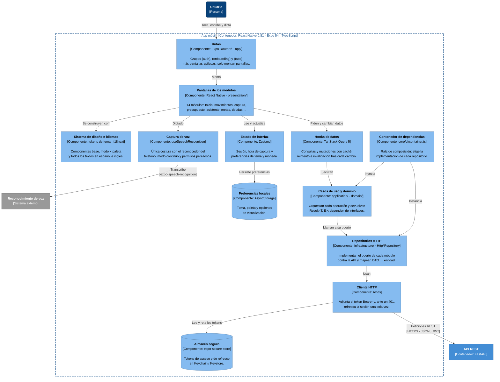

*Figura 6. Componentes de la app móvil.*

#### Componentes

| Componente                      | Tecnología                                           | Responsabilidad                                                                                                                                                                                                                           |
| ------------------------------- | ---------------------------------------------------- | ----------------------------------------------------------------------------------------------------------------------------------------------------------------------------------------------------------------------------------------- |
| **Rutas**                       | Expo Router 6 (`app/`)                               | Navegación basada en archivos: grupos `(auth)`, `(onboarding)` y `(tabs)` —Inicio, Movimientos, Presupuesto y Asistente— más pantallas apiladas como cuentas, metas, deudas o El Corte. Las rutas solo montan pantallas.                  |
| **Pantallas de los módulos**    | React Native (`presentation/`)                       | Pantallas y componentes visuales de cada uno de los 14 módulos.                                                                                                                                                                           |
| **Sistema de diseño e idiomas** | Tokens de tema, i18next                              | Componentes base, tema en dos ejes (modo claro u oscuro × paleta) y todos los textos en español e inglés, sin cadenas fijas en el código (RNF-14).                                                                                        |
| **Captura de voz**              | `useSpeechRecognition` sobre expo-speech-recognition | Única costura con el reconocedor del teléfono: escucha en modo continuo para que una pausa no corte la frase, pide permisos solo en el primer uso y une los segmentos de Android e iOS en una sola transcripción.                         |
| **Estado de interfaz**          | Zustand                                              | Estado que no viene del servidor: sesión, hoja de captura abierta, preferencias de tema, paleta y moneda.                                                                                                                                 |
| **Hooks de datos**              | TanStack Query 5                                     | Estado que sí viene del servidor: caché, reintentos e invalidación. Cualquier cambio de dinero invalida todas las vistas de plata —Inicio, cuentas, movimientos, topes, metas, deudas— para que ninguna pantalla muestre una cifra vieja. |
| **Casos de uso y dominio**      | TypeScript (`application/`, `domain/`)               | Orquestan cada operación contra una interfaz de repositorio y devuelven `Result<T, E>` en lugar de lanzar excepciones.                                                                                                                    |
| **Contenedor de dependencias**  | `core/di/container.ts`                               | Raíz de composición del cliente: decide qué implementación usa cada repositorio. Cambiar de una implementación en memoria a la real es cambiar una línea aquí.                                                                            |
| **Repositorios HTTP**           | `Http*Repository` (`infrastructure/`)                | Implementan el puerto de cada módulo contra la API y traducen DTO ↔ entidad.                                                                                                                                                              |
| **Cliente HTTP**                | Axios                                                | Adjunta `Authorization: Bearer`. Ante un 401 hace un único refresco compartido por las peticiones simultáneas y reintenta; si el refresco falla, cierra la sesión.                                                                        |
| **Almacén seguro**              | expo-secure-store                                    | Tokens de acceso y de refresco, cifrados por el sistema operativo (Keychain en iOS, Keystore en Android).                                                                                                                                 |
| **Preferencias locales**        | AsyncStorage                                         | Preferencias no sensibles que deben sobrevivir al cierre de la app.                                                                                                                                                                       |

#### Módulos de la app y su contraparte en el backend

| Módulo          | Qué contiene                                                         | Habla con                | Estado                                              |
| --------------- | -------------------------------------------------------------------- | ------------------------ | --------------------------------------------------- |
| `auth`          | Ingreso, registro, verificación de correo y sesión                   | `auth`                   | API real                                            |
| `onboarding`    | Recorrido inicial: nombre, objetivo, idioma, moneda y primera cuenta | `auth`, `accounts`       | API real; el borrador del recorrido vive en memoria |
| `home`          | Inicio                                                               | `overview`               | API real                                            |
| `expenses`      | Hoja de captura: voz, «Escribir» y formulario manual                 | `assistant`, `movements` | API real                                            |
| `movements`     | Historial con filtros, edición y borrado                             | `movements`              | API real                                            |
| `accounts`      | Cuentas y tarjetas de crédito                                        | `accounts`               | API real                                            |
| `categories`    | Categorías estándar y propias                                        | `categories`             | API real                                            |
| `budgets`       | Techo global y topes por categoría                                   | `budgets`                | API real                                            |
| `subscriptions` | Suscripciones y cobros pendientes                                    | `subscriptions`          | API real                                            |
| `deudas`        | Deudas, abonos y gasto compartido                                    | `debts`                  | API real                                            |
| `goals`         | Metas, aportes y retiros                                             | `goals`                  | API real                                            |
| `assistant`     | Chat, borradores, avisos, El Corte y revisión semanal                | `assistant`              | API real                                            |
| `profile`       | Perfil y preferencias                                                | `auth`                   | API real                                            |
| `plan`          | Oferta Plus y consumo del plan                                       | `billing` *(planeado)*   | En memoria hasta la fase de cobro                   |

---

## 5. Nivel 4 · Código

> **Pregunta que responde:** ¿cómo está implementado, clase por clase, el componente que mueve el
> dinero?

Se eligió el módulo `**movements**` porque es el libro contable de Deshka: todo lo que mueve plata
—el formulario manual, la captura por voz, los cobros de suscripciones, los aportes a metas y los
préstamos— termina en `CreateMovementUseCase`. C4 considera opcional este nivel y recomienda
dibujarlo solo para los componentes más importantes o complejos; por eso se presenta para este
único componente. Los diagramas usan notación de clases UML: la flecha punteada con triángulo hueco
significa *implementa*, el rombo relleno es composición y el rombo hueco, agregación.

### 5.1 Dominio, aplicación y puertos

El hexágono: lo que el módulo **sabe hacer** sin conocer ninguna tecnología.

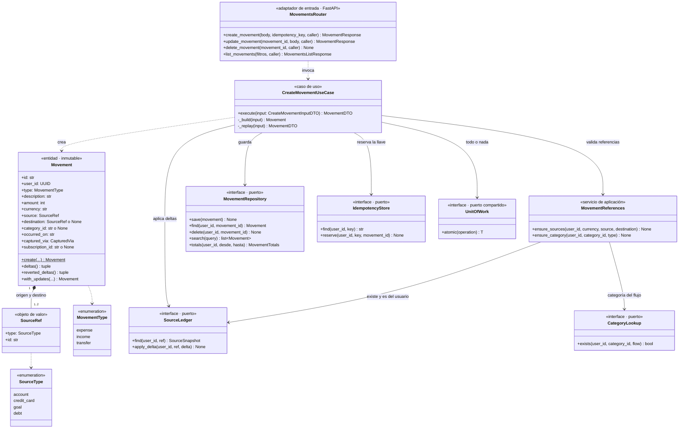

*Figura 7. El hexágono de `movements`. El router también invoca los casos de uso de editar,
borrar y listar, que siguen el mismo patrón y se omiten para no repetir.*

| Clase                                                                      | Capa                 | Responsabilidad                                                                                                                                                                                                      |
| -------------------------------------------------------------------------- | -------------------- | -------------------------------------------------------------------------------------------------------------------------------------------------------------------------------------------------------------------- |
| `MovementsRouter`                                                          | Adaptador de entrada | Traduce HTTP a casos de uso. Toma el usuario y la moneda del JWT (`CallerContext`), nunca del cuerpo, y lee el encabezado `Idempotency-Key`.                                                                         |
| `CreateMovementUseCase`                                                    | Aplicación           | Valida, construye el movimiento y, dentro de una sola transacción, reserva la llave de idempotencia, lo guarda y aplica su efecto sobre cada fuente. Si la llave ya existe, devuelve el movimiento original.         |
| `MovementReferences`                                                       | Aplicación           | Comprueba que la fuente, el destino y la categoría existan, sean del usuario y estén en su moneda. Lo comparten crear y editar, para que ambos rechacen exactamente lo mismo.                                        |
| `Movement`                                                                 | Dominio              | El registro de un movimiento. El monto siempre es positivo y en unidad menor; el signo lo decide el tipo. `deltas()` contiene **toda la regla de caja** y `reverted_deltas()` la deshace al editar o borrar (RN-27). |
| `SourceRef`                                                                | Dominio              | Dónde está la plata: una cuenta, una tarjeta, el bolsillo de una meta o una deuda. El movimiento solo guarda la referencia; resolverla es trabajo del puerto `SourceLedger`.                                         |
| `MovementRepository`, `SourceLedger`, `CategoryLookup`, `IdempotencyStore` | Puertos              | Lo que el módulo necesita del exterior, declarado como interfaces (`typing.Protocol`).                                                                                                                               |
| `UnitOfWork`                                                               | Puerto compartido    | Ejecuta varias escrituras como una unidad de todo o nada. Vive en `shared/` porque varios módulos lo usan.                                                                                                           |

### 5.2 Adaptadores

Las clases que **implementan** los puertos con tecnología concreta. El hexágono no las conoce: la raíz
de composición las crea y se las entrega.

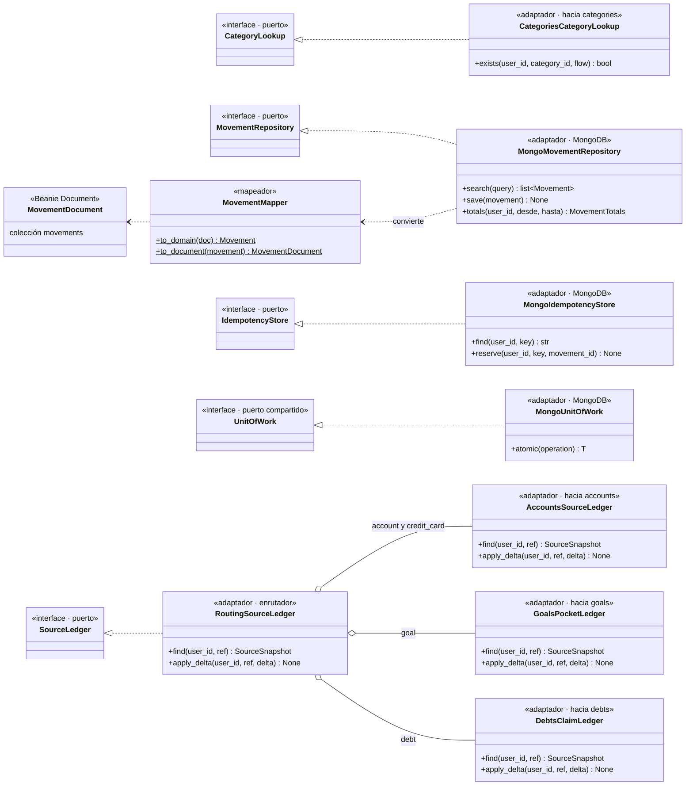

*Figura 8. Adaptadores que implementan los puertos de `movements`.*

| Adaptador                               | Implementa               | Cómo lo hace                                                                                                                                                                                                                                                                                      |
| --------------------------------------- | ------------------------ | ------------------------------------------------------------------------------------------------------------------------------------------------------------------------------------------------------------------------------------------------------------------------------------------------- |
| `MongoMovementRepository`               | `MovementRepository`     | Consultas siempre filtradas por `user_id` y servidas por el índice `(user_id, occurred_on, created_at)`. Las sumas del periodo las calcula MongoDB con agregaciones, no la aplicación en memoria. `MovementMapper` separa la entidad del documento Beanie.                                        |
| `RoutingSourceLedger`                   | `SourceLedger`           | Un solo puerto para todo tipo de fuente: según el tipo de la referencia (`account` o `credit_card`, `goal`, `debt`) delega en uno de los tres adaptadores de abajo. El hexágono sigue viendo un único puerto; dónde está la plata es asunto del adaptador.                                        |
| `AccountsSourceLedger`                  | — (pieza del enrutador)  | Lee la cuenta o la tarjeta por los puertos del módulo `accounts` y aplica el delta con un `$inc` atómico: suma al **saldo** de la cuenta o resta a la **deuda** de la tarjeta, porque para un pasivo mejorar la posición es deber menos.                                                          |
| `GoalsPocketLedger`, `DebtsClaimLedger` | — (piezas del enrutador) | Verifican que la meta o la deuda existan y sean del usuario. Su `apply_delta` no hace nada a propósito: lo ahorrado y lo prestado **son** la suma de sus transferencias y se recalculan al leer, así que no hay saldo guardado que pueda descuadrarse.                                            |
| `CategoriesCategoryLookup`              | `CategoryLookup`         | Busca primero en el catálogo estándar en código (sin consulta) y solo si no está, en las categorías propias del usuario.                                                                                                                                                                          |
| `MongoIdempotencyStore`                 | `IdempotencyStore`       | Colección con índice único `(user_id, key)` que expira sola al día. Si dos peticiones con la misma llave compiten, una gana y la otra recibe el movimiento de la ganadora.                                                                                                                        |
| `MongoUnitOfWork`                       | `UnitOfWork`             | Abre una transacción multi-documento con reintento ante fallas transitorias y publica la sesión en un `ContextVar`, de modo que los repositorios se suman a la transacción sin que la capa de aplicación sepa que existen sesiones de MongoDB. Si ya hay una transacción en curso, se une a ella. |

### 5.3 Cómo colaboran: registrar un movimiento

Lo que ocurre dentro del componente cuando llega un `POST /movements`, por ejemplo un almuerzo
pagado con tarjeta de crédito.

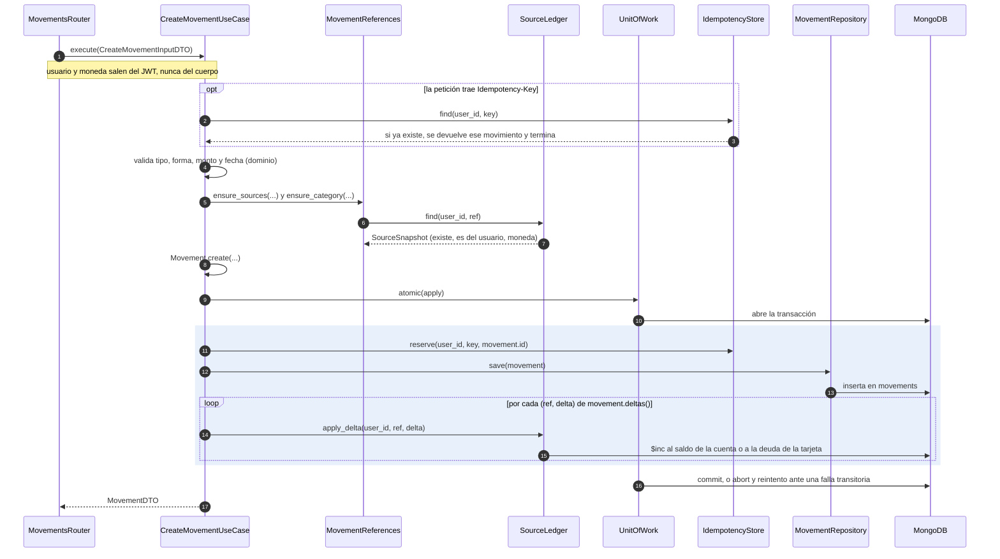

*Figura 9. Secuencia de `POST /movements`. El bloque sombreado ocurre dentro de una sola
transacción: o se aplica completo o no se aplica.*

La validación ocurre **antes** de abrir la transacción, para que dentro solo haya escrituras. Esto
importa porque `MongoUnitOfWork` puede reejecutar la operación si MongoDB reporta una falla
transitoria, y repetir escrituras con los mismos identificadores produce el mismo resultado.

### 5.4 Las reglas que viven en este código

#### La regla de caja, en un solo método

`Movement.deltas()` es la regla de caja completa (RN-01): cada movimiento se traduce en cambios de
posición sobre sus fuentes, y quien aplica el delta lo interpreta según el tipo de fuente.

| Tipo       | Efecto                        | Ejemplo                                                                                                                     |
| ---------- | ----------------------------- | --------------------------------------------------------------------------------------------------------------------------- |
| `expense`  | fuente −monto                 | Almuerzo de 25.000 con la tarjeta: delta −25.000 sobre la tarjeta, y su **deuda sube** 25.000.                              |
| `income`   | fuente +monto                 | Salario de 3.000.000 a «Nómina»: el saldo sube 3.000.000.                                                                   |
| `transfer` | origen −monto, destino +monto | Pago de 500.000 a la tarjeta desde «Nómina»: el saldo baja 500.000, la **deuda baja** 500.000 y el gasto del mes no cambia. |

De esa única tabla salen todos los casos del modelo de caja: el consumo con tarjeta es gasto, el pago
de la tarjeta es transferencia y no vuelve a contar, y aportar a una meta o prestarle a alguien baja
el saldo sin tocar el gasto del mes (RN-13).

#### Coherencia de cada tipo

| Tipo       | Origen                                                            | Destino                           | Categoría                      |
| ---------- | ----------------------------------------------------------------- | --------------------------------- | ------------------------------ |
| `expense`  | Obligatorio: cuenta o tarjeta (o una deuda, solo para condonarla) | No lleva                          | Opcional, del flujo de gasto   |
| `income`   | Obligatorio: solo una cuenta                                      | No lleva                          | Opcional, del flujo de ingreso |
| `transfer` | Obligatorio                                                       | Obligatorio y distinto del origen | No lleva                       |

Una meta o una deuda solo pueden ser **extremo de una transferencia**, nunca los dos extremos a la
vez, y ninguna petición HTTP puede nombrarlas como fuente: solo sus módulos dueños crean esos
movimientos, a través de sus puertos.

#### Garantías

- **Atomicidad (RNF-09):** el movimiento y su efecto sobre los saldos se escriben en la misma
transacción; borrar o editar revierte el efecto en esa misma transacción.
- **Idempotencia:** un doble toque en «Guardar» con la misma `Idempotency-Key` devuelve el
movimiento original en vez de crear otro.
- **Aislamiento por usuario (RNF-08):** toda consulta y toda escritura llevan el `user_id` del JWT.
- **Lo derivado no se guarda:** lo ahorrado en una meta y el saldo de una deuda se calculan a partir
de los movimientos; no existe un número guardado que pueda contradecirlos.
- **Dinero exacto (RNF-15):** montos enteros en la unidad menor de la moneda —pesos en COP, centavos
en USD—; nunca decimales de punto flotante.

---

## 6. Diagramas complementarios

### 6.1 Diagrama dinámico: registrar un gasto por voz

El diagrama dinámico muestra cómo colaboran los contenedores en un caso de uso concreto. Este es el
recorrido que justifica el primer pilar del producto, *registrar sin fricción*.

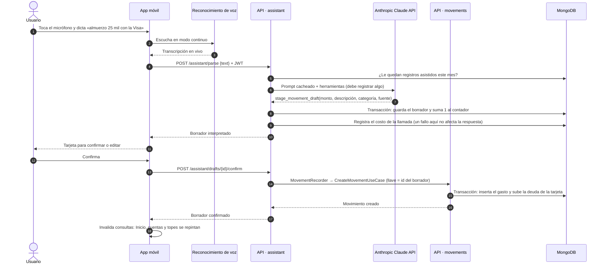

*Figura 10. Diagrama dinámico del registro de un gasto por voz.*

Lo que este recorrido deja ver:

- **El usuario solo hace dos cosas además de dictar**: tocar el micrófono y confirmar (RNF-11).
- **Al servidor solo llega texto.** La transcripción ocurre en el teléfono (pasos 2 y 3).
- **La cuota se revisa antes de gastar**: si el usuario ya no tiene registros asistidos en el mes, la
API responde con el límite sin llamar al modelo (paso 5).
- **El modelo debe registrar algo.** La primera llamada lo obliga a usar una herramienta de registro
—movimiento, deuda o abono, según lo que entienda de la frase—. Una frase puede producir varios
borradores («10 en café y 5 en papitas»), y si el modelo necesita aclarar algo responde con una
pregunta que no consume cuota.
- **La IA propone y el usuario decide** (RN-22): ningún movimiento existe hasta que el usuario
confirma (paso 12), y el borrador puede editarse antes de hacerlo.
- **La confirmación usa la misma puerta que el formulario manual** (paso 14), con el id del borrador
como llave de idempotencia: un doble toque converge en un solo movimiento.
- **Cada llamada al modelo deja su costo** en el registro de acciones de IA, invisible para el
usuario (RNF-22).

### 6.2 Diagrama de despliegue

Deshka todavía no está en producción. Hoy corre en un entorno de desarrollo completo: el backend en
Docker Compose y la app instalada en teléfonos reales como *development build* (un binario propio,
necesario porque el reconocimiento de voz nativo no funciona en Expo Go).

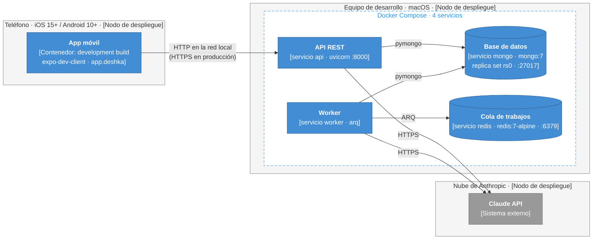

*Figura 11. Despliegue del entorno actual.*

El paso a producción ya tiene destino definido para casi todas las piezas:

| Pieza              | Hoy                                   | Destino en producción                                                                               | Estado |
| ------------------ | ------------------------------------- | --------------------------------------------------------------------------------------------------- | ------ |
| API REST y worker  | Servicios de Docker Compose           | Un proveedor de hosting de contenedores, detrás de HTTPS (por definir; se evalúan Railway y Fly.io) | ⏳      |
| Base de datos      | `mongo:7` en *replica set* de un nodo | MongoDB Atlas (*replica set* administrado)                                                          | ⏳      |
| Cola de trabajos   | `redis:7-alpine`                      | Upstash Redis                                                                                       | ⏳      |
| Almacén de recibos | —                                     | Cloudflare R2                                                                                       | ⏳      |
| App móvil          | *Development build* instalado a mano  | Builds con EAS, distribuidos por App Store y Google Play                                            | ⏳      |
| Observabilidad     | Logs estructurados (structlog)        | Logs estructurados + Sentry para errores                                                            | ⏳      |
| Correo             | El código se escribe en el log        | Resend                                                                                              | ⏳      |

---

## 7. Decisiones de arquitectura y requisitos no funcionales

Cada requisito no funcional del Entregable #1 que tiene una respuesta arquitectónica, y dónde se ve
en este modelo:

| Requisito                                            | Cómo lo atiende la arquitectura                                                                                                                                             | Dónde se ve   |
| ---------------------------------------------------- | --------------------------------------------------------------------------------------------------------------------------------------------------------------------------- | ------------- |
| **RNF-01** · Voz en menos de 5 s                     | La transcripción ocurre en el teléfono y viaja como texto; la captura reutiliza un prompt cacheado y obliga al modelo a registrar en su primera llamada.                    | 3.1, 6.1      |
| **RNF-02** · Inicio en menos de 2 s                  | `GET /home/overview` arma Inicio en una sola respuesta, y las sumas las hace MongoDB con agregaciones sobre índices, no la aplicación en memoria.                           | 4.1, 5.2      |
| **RNF-03** · Respuesta del agente en menos de 8 s    | *Prompt caching* (herramientas y prompt de sistema estáticos por idioma), máximo 6 iteraciones de herramientas por turno e historial acotado a 24 mensajes.                 | 4.1           |
| **RNF-05** · Tolerancia a fallas de la IA            | Si el modelo falla, El Corte y la revisión salen con plantillas fijas; en el chat, una falla del proveedor responde sin consumir cuota y sin perder el mensaje del usuario. | 2.4, 4.1      |
| **RNF-06** · Contraseñas con derivación de clave     | Argon2 (`Argon2Hasher`) detrás del puerto `PasswordHasher`.                                                                                                                 | 4.1           |
| **RNF-07** · HTTPS y token vigente                   | JWT Bearer validado en cada petición, acceso de 15 minutos y refresco rotativo de 30 días; HTTPS en producción.                                                             | 3.5, 4.1, 6.2 |
| **RNF-08** · Datos acotados al usuario               | El `user_id` sale del JWT y filtra cada consulta; ningún endpoint lo acepta en el cuerpo.                                                                                   | 4.1, 5.4      |
| **RNF-09** · Operaciones atómicas                    | Puerto `UnitOfWork` implementado con transacciones multi-documento de MongoDB sobre *replica set*.                                                                          | 3.5, 5.3      |
| **RNF-10** · Procesos programados idempotentes       | Índices únicos: `(usuario, tipo, periodo)` en las entregas del agente y `(usuario, suscripción, fecha)` en los cobros; los trabajos pueden reejecutarse sin duplicar.       | 3.5, 6.1      |
| **RNF-14** · Español e inglés sin textos fijos       | i18next en la app; prompts del agente por idioma en el backend.                                                                                                             | 4.3           |
| **RNF-15** · Montos en unidad menor                  | Enteros en la unidad menor, con un solo lugar que conoce el exponente de cada moneda (`shared/domain/money.py`, y su tabla gemela en la app).                               | 4.1, 5.4      |
| **RNF-17** · Tipado estricto y reglas de dependencia | `mypy --strict` y TypeScript estricto; 41 contratos de `import-linter` en el backend y `eslint-plugin-boundaries` en la app.                                                | 4.1, 4.3      |
| **RNF-21** · Entregas en segundo plano               | Worker con ARQ y Redis, separado de la API: los barridos no afectan los tiempos de respuesta.                                                                               | 3.1           |
| **RNF-22** · Costo de cada operación de IA           | Cada llamada al modelo queda en `assistant_action_logs` con sus tokens y su costo en dólares, sin exponerse al usuario.                                                     | 4.1, 6.1      |

---

## 8. Glosario

| Término                         | Significado                                                                                                                                              |
| ------------------------------- | -------------------------------------------------------------------------------------------------------------------------------------------------------- |
| **Adaptador**                   | Clase que conecta el núcleo de un módulo con una tecnología concreta (MongoDB, FastAPI, Anthropic) o con otro módulo, implementando un puerto.           |
| **Agente**                      | La parte de Deshka que usa un modelo de lenguaje para conversar, interpretar capturas y redactar resúmenes; además produce avisos calculados con reglas. |
| **Arquitectura hexagonal**      | Estilo de arquitectura, también llamado *puertos y adaptadores*, en el que el dominio queda en el centro y todo lo externo se conecta por interfaces.    |
| **Borrador**                    | Movimiento o deuda que el agente interpretó y que todavía no existe: espera la confirmación del usuario.                                                 |
| **Capa anticorrupción**         | Adaptador que traduce entre los conceptos de dos módulos para que ninguno dependa del modelo interno del otro.                                           |
| **Caso de uso**                 | Operación que un módulo ofrece hacia afuera, como `CreateMovementUseCase`. Es el puerto de entrada del hexágono.                                         |
| **El Corte**                    | Resumen del mes anterior que el agente entrega el día 1, contado en una secuencia de pantallas.                                                          |
| **Idempotencia**                | Propiedad de una operación que, ejecutada varias veces con los mismos datos, produce el mismo resultado que una sola vez.                                |
| **Jugada**                      | Acción concreta que propone el agente en la revisión semanal —crear un tope, aportar a una meta— y que el usuario puede aplicar con un toque.            |
| **JWT**                         | *JSON Web Token*: credencial firmada que la app envía en cada petición para demostrar quién es el usuario.                                               |
| **Modelo de caja (cash-basis)** | Regla contable de Deshka: el consumo con tarjeta es gasto y aumenta la deuda; el pago de la tarjeta es transferencia y no vuelve a contar como gasto.    |
| **Monolito modular**            | Una sola aplicación desplegable cuyo código está dividido en módulos con fronteras estrictas.                                                            |
| **Prompt caching**              | Técnica del proveedor de IA que reutiliza la parte fija de una petición ya procesada, para responder más rápido y más barato.                            |
| **Puerto**                      | Interfaz que un módulo declara para pedir algo al exterior sin saber quién lo implementa.                                                                |
| **Raíz de composición**         | El único lugar del código donde se crean las implementaciones concretas y se conectan con los casos de uso.                                              |
| ***Replica set***               | Grupo de servidores MongoDB que mantienen copias de los mismos datos; es requisito para usar transacciones multi-documento.                              |
| **Tool use**                    | Capacidad del modelo de lenguaje de pedir la ejecución de herramientas que el sistema le ofrece, como consultar el gasto del mes o preparar un borrador. |
| **Unidad menor**                | La fracción más pequeña de una moneda: centavos en USD, pesos en COP. Todos los montos se guardan como enteros en esa unidad.                            |
| **Worker**                      | Proceso en segundo plano que ejecuta trabajos programados, sin atender peticiones de la app.                                                             |

---

## 9. Referencias

- Brown, S. *The C4 model for visualising software architecture*. [https://c4model.com](https://c4model.com)
- Cockburn, A. (2005). *Hexagonal architecture*. [https://alistair.cockburn.us/hexagonal-architecture/](https://alistair.cockburn.us/hexagonal-architecture/)
- Evans, E. (2003). *Domain-Driven Design: Tackling Complexity in the Heart of Software*. Addison-Wesley.
- Mermaid. *Documentación de diagramas de flujo, de clases y de secuencia*. [https://mermaid.js.org](https://mermaid.js.org)
- Deshka · Entregable #1: modelo verbal, requisitos de usuario, funcionales y no funcionales, y reglas
de negocio.
- Deshka · [Diagrama de clases de diseño](./diagrama-de-clases.md): las entidades del dominio que este
modelo ubica dentro de sus componentes.

---

**Deshka** · Sebastián Mejía Narváez · Alexandra Guerrero Bocanegra
Diseño de Sistemas de Información · Instituto Tecnológico Metropolitano · Medellín, 2026