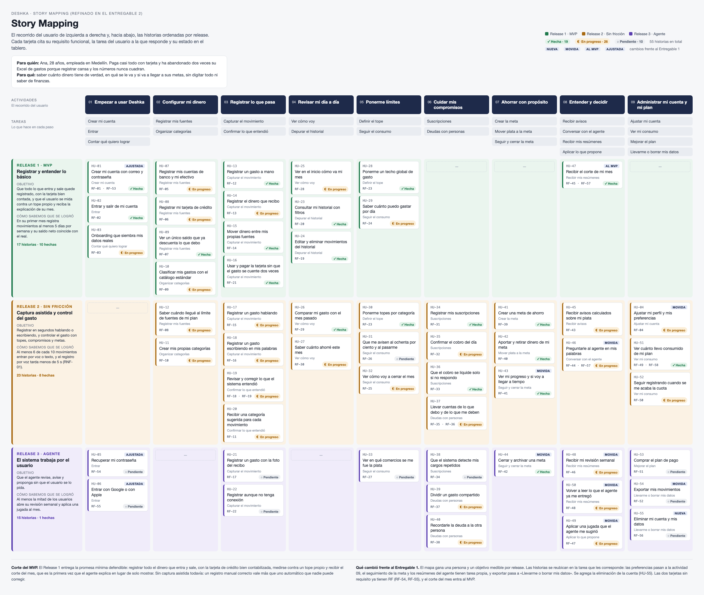

# Story map

El recorrido del usuario de izquierda a derecha; hacia abajo, las funcionalidades ordenadas por release. Cada tarjeta del mapa corresponde a **una** historia de este catálogo.

## Release 1 · MVP — Registrar y entender lo básico

**01 · Empezar a usar Deshka**

- `HU-01` Crear mi cuenta con correo y contraseña — *RF-01, RF-53*
- `HU-02` Entrar y salir de mi cuenta — *RF-02*
- `HU-03` Onboarding que siembra mis datos reales — *RF-03*

**02 · Configurar mi dinero**

- `HU-07` Registrar mis cuentas de banco y mi efectivo — *RF-05*
- `HU-08` Registrar mi tarjeta de crédito — *RF-06*
- `HU-09` Ver un único saldo que ya descuenta lo que debo — *RF-07*
- `HU-10` Clasificar mis gastos con el catálogo estándar — *RF-09*

**03 · Registrar lo que pasa**

- `HU-13` Registrar un gasto a mano — *RF-12*
- `HU-14` Registrar el dinero que recibo — *RF-13*
- `HU-15` Mover dinero entre mis propias fuentes — *RF-14*
- `HU-16` Usar y pagar la tarjeta sin que el gasto se cuente dos veces — *RF-21*

**04 · Revisar mi día a día**

- `HU-23` Consultar mi historial con filtros — *RF-20*
- `HU-24` Editar y eliminar movimientos del historial — *RF-19*
- `HU-25` Ver en el inicio cómo va mi mes — *RF-28*

**05 · Ponerme límites**

- `HU-28` Ponerme un techo global de gasto — *RF-23*
- `HU-29` Saber cuánto puedo gastar por día — *RF-24*

**08 · Entender y decidir**

- `HU-47` Recibir el corte de mi mes — *RF-45, RF-57*

## Release 2 · Sin fricción — Captura asistida y control del gasto

**02 · Configurar mi dinero**

- `HU-11` Crear mis propias categorías — *RF-10*
- `HU-12` Saber cuándo llegué al límite de fuentes de mi plan — *RF-08*

**03 · Registrar lo que pasa**

- `HU-17` Registrar un gasto hablando — *RF-15*
- `HU-18` Registrar un gasto escribiendo en mis palabras — *RF-16*
- `HU-19` Revisar y corregir lo que el sistema entendió — *RF-18, RF-19*
- `HU-20` Recibir una categoría sugerida para cada movimiento — *RF-11*

**04 · Revisar mi día a día**

- `HU-26` Comparar mi gasto con el mes pasado — *RF-29*
- `HU-27` Saber cuánto ahorré este mes — *RF-30*

**05 · Ponerme límites**

- `HU-30` Ponerme topes por categoría — *RF-23*
- `HU-31` Que me avisen al ochenta por ciento y al pasarme — *RF-26*
- `HU-32` Ver cómo voy a cerrar el mes — *RF-25*

**06 · Cuidar mis compromisos**

- `HU-34` Registrar mis suscripciones — *RF-31*
- `HU-35` Confirmar el cobro del día — *RF-32*
- `HU-36` Que el cobro se liquide solo si no respondo — *RF-33*
- `HU-37` Llevar cuentas de lo que debo y de lo que me deben — *RF-35, RF-36*

**07 · Ahorrar con propósito**

- `HU-41` Crear una meta de ahorro — *RF-39*
- `HU-42` Aportar y retirar dinero de mi meta — *RF-40*
- `HU-43` Ver mi progreso y si voy a llegar a tiempo — *RF-41*

**08 · Entender y decidir**

- `HU-45` Recibir avisos calculados sobre mi plata — *RF-43*
- `HU-46` Preguntarle al agente en mis palabras — *RF-44, RF-57*

**09 · Administrar mi cuenta y mi plan**

- `HU-04` Ajustar mi perfil y mis preferencias — *RF-04*
- `HU-51` Ver cuánto llevo consumido de mi plan — *RF-49, RF-58*
- `HU-52` Seguir registrando cuando se me acaba la cuota — *RF-50*

## Release 3 · Agente — El sistema trabaja por el usuario

**01 · Empezar a usar Deshka**

- `HU-05` Recuperar mi contraseña — *RF-54*
- `HU-06` Entrar con Google o con Apple — *RF-55*

**03 · Registrar lo que pasa**

- `HU-21` Registrar un gasto con la foto del recibo — *RF-17*
- `HU-22` Registrar aunque no tenga conexión — *RF-22*

**05 · Ponerme límites**

- `HU-33` Ver en qué comercios se me fue la plata — *RF-27*

**06 · Cuidar mis compromisos**

- `HU-38` Que el sistema detecte mis cargos repetidos — *RF-34*
- `HU-39` Dividir un gasto compartido — *RF-37*
- `HU-40` Recordarle la deuda a la otra persona — *RF-38*

**07 · Ahorrar con propósito**

- `HU-44` Cerrar y archivar una meta — *RF-42*

**08 · Entender y decidir**

- `HU-48` Recibir mi revisión semanal — *RF-46*
- `HU-49` Aplicar una jugada que el agente me sugirió — *RF-47*
- `HU-50` Volver a leer lo que el agente ya me entregó — *RF-48*

**09 · Administrar mi cuenta y mi plan**

- `HU-53` Comprar el plan de pago — *RF-51*
- `HU-54` Exportar mis movimientos — *RF-52*
- `HU-55` Eliminar mi cuenta y mis datos — *RF-56*

## El corte del MVP

El Release 1 entrega la promesa mínima defendible: registrar todo el dinero que entra y sale, con la tarjeta de crédito bien contabilizada, medirse contra un tope propio y recibir el corte del mes, que es la primera vez que el agente explica en lugar de solo mostrar. Sin captura asistida todavía, porque un registro manual correcto vale más que uno automático que nadie puede corregir.
